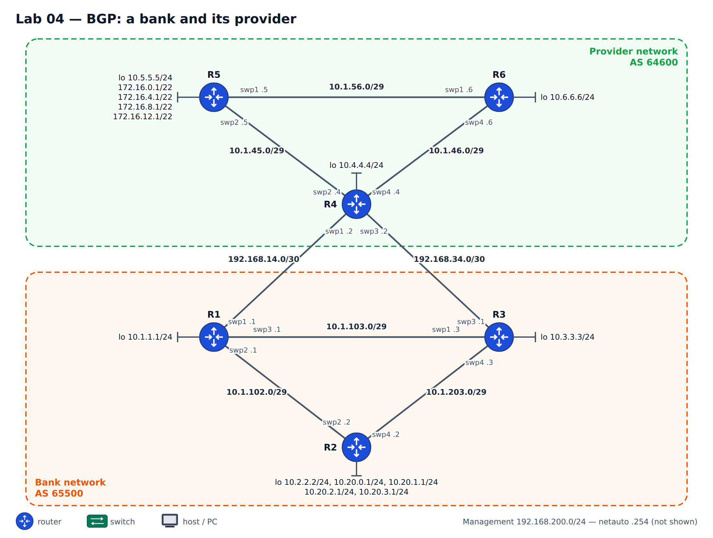

# Lab 04 — BGP as code: a bank and its provider (2nd project, exercise 1)

**Topics:** OSPF inside each AS, iBGP full mesh, eBGP between ASes, next-hop reachability,
route aggregation, local preference for inbound and outbound traffic selection — configured
**only through the automation pipeline**: a YAML intent validated against the YANG model,
pushed over **RESTCONF**, and checked by a script that reads the routers' state.



```bash
python tools/cgr_lab.py build labs/lab04-bgp --start
```

## Addressing

(Previous years' statement labelled three provider links 10.1.405/406/506.0/29, which are not
valid IPv4 networks; this year they are **10.1.45.0/29**, **10.1.46.0/29** and **10.1.56.0/29**,
and R4 has the loopback **10.4.4.4/24**. The figure above already uses these addresses.)

| Link | Subnet | Ports | Addresses |
|---|---|---|---|
| R1–R4 (eBGP) | 192.168.14.0/30 | R1 swp1 — R4 swp1 | R1 .1, R4 .2 |
| R3–R4 (eBGP) | 192.168.34.0/30 | R3 swp3 — R4 swp3 | R3 .1, R4 .2 |
| R1–R2 | 10.1.102.0/29 | R1 swp2 — R2 swp2 | R1 .1, R2 .2 |
| R1–R3 | 10.1.103.0/29 | R1 swp3 — R3 swp1 | R1 .1, R3 .3 |
| R2–R3 | 10.1.203.0/29 | R2 swp4 — R3 swp4 | R2 .2, R3 .3 |
| R4–R5 | **10.1.45.0/29** | R4 swp2 — R5 swp2 | R4 .4, R5 .5 |
| R4–R6 | **10.1.46.0/29** | R4 swp4 — R6 swp4 | R4 .4, R6 .6 |
| R5–R6 | **10.1.56.0/29** | R5 swp1 — R6 swp1 | R5 .5, R6 .6 |

| Router | AS | Loopback addresses (all on `lo`) | Management |
|---|---|---|---|
| R1 | 65500 (Bank) | 10.1.1.1/24 | 192.168.200.21 |
| R2 | 65500 | 10.2.2.2/24; 10.20.0.1/24, 10.20.1.1/24, 10.20.2.1/24, 10.20.3.1/24 (Lo200–203) | .22 |
| R3 | 65500 | 10.3.3.3/24 | .23 |
| R4 | 64600 (Provider) | **10.4.4.4/24** | .24 |
| R5 | 64600 | 10.5.5.5/24; 172.16.0.1/22, 172.16.4.1/22, 172.16.8.1/22, 172.16.12.1/22 (Lo0/4/8/12) | .25 |
| R6 | 64600 | 10.6.6.6/24 | .26 |

netauto: 192.168.200.254.

## Requirements

The network must meet these requirements (the same as last year's BGP scenario):

1. Use the addressing scheme above.
2. Configure OSPF inside the Bank network with a single area (area 0).
3. Configure OSPF inside the Provider network with a single area (area 0).
4. The Bank network is BGP **AS 65500** and the Provider network is BGP **AS 64600**.
5. **Do not include** the 192.168.14.0/30 and 192.168.34.0/30 networks in the OSPF instances
   of the two ASes.
6. All routers take part in BGP. Configure a **full mesh of iBGP** peers in each AS.
7. In the Bank network, the networks of Lo200–Lo203 on R2 are advertised via BGP **as a
   summary**; these are the only networks the Bank AS advertises via BGP.
8. R5 sends a **summary route** via BGP to the Bank network representing the Lo0, Lo4, Lo8 and
   Lo12 loopbacks; these are the only prefixes the Provider AS announces via BGP.
9. R4 **prefers the path via the R4–R3 link** to reach the Bank network.
10. Routers in the Bank network **prefer the R1–R4 link** to reach the Provider networks.
11. Test connectivity between the BGP-announced networks of R5 and R2
    (`ping -I 10.20.0.1 172.16.4.1` on R2, `traceroute -s …`).

## The rule: no CLI configuration

In this exercise the routers are configured **only by automation**, from **netauto**
(`/root/cgr`): an intent file pushed over RESTCONF. `vtysh`, `ip`, `ping` and `traceroute`
on the routers are fine for *looking*, never for configuring. (The routers refuse a push that
would remove something configured by hand, so mixing the two shows.) See
[automation/README.md](../../automation/README.md) for the model, the RESTCONF server and the
tools; `pyang -f tree yang/cgr-device@2026-09-15.yang` shows what the model can express.

## Part A — the intent

Write **one** intent file, `intent/lab04.yml`, with the six routers (interfaces, loopbacks, OSPF,
BGP) and push it:

```bash
cd /root/cgr
./apply_intent.py intent/lab04.yml --check             # validate against the YANG model only
./apply_intent.py intent/lab04.yml --restconf --diff   # what would change on each router
./apply_intent.py intent/lab04.yml --restconf          # push (one RESTCONF PUT per router)
./apply_intent.py intent/lab04.yml --restconf --diff   # again: "no changes" everywhere = idempotent
```

BGP in the model: `bgp: {asn, router-id, network: [...], aggregate: [{prefix, summary-only}],
neighbor: [{address, remote-as, update-source, next-hop-self, local-preference-in,
as-path-prepend-out}]}`. `network` only announces a prefix that is in the routing table with
exactly that mask. The routers use FRR's *datacenter* defaults (eBGP sessions exchange routes
without an explicit policy).

## Part B — the check script

Write `scripts/check_bgp.py`: a program that reads the **state** of the routers over RESTCONF
and checks **each requirement** (2–11), printing PASS/FAIL per check and exiting with 0 only
if all pass. `scripts/check_bgp.py` is started for you (it checks requirement 6); the state
the routers expose:

```bash
./restconf.py R4 get state/route --content nonconfig          # routing table: prefix, protocol, next-hop
./restconf.py R4 get state/bgp-neighbor --content nonconfig   # address, remote-as, state, prefixes-received
./restconf.py R1 get state/ospf-neighbor --content nonconfig
./restconf.py R2 get state/interface --content nonconfig
```

For requirement 11 the script may also log in over SSH (`cgrlib.Device`, see
`collect.py`) to run `ping`/`traceroute` — careful: a router answers a traceroute from the
address of its interface **towards the source**, which is not always the link the probe came in on.

## Part C — change and failure

1. **Change request.** The Bank adds four networks on R2: `10.20.4.1/24`, `10.20.5.1/24`,
   `10.20.6.1/24`, `10.20.7.1/24`. It must still announce **a single summary**, now covering
   the eight networks. Make the change in the intent file only and push it; your check script
   must pass again (adapt it if needed).
2. **Failure.** Disable the R3–R4 link **through RESTCONF** (interface `enabled: false` — a
   PATCH of `interface=swp3` on R3). Before you do it, write down which path R4, R5 and R2 will
   use and whether requirement 11 still holds; then check. Enable it again.
3. **Inbound traffic.** The Bank wants the Provider's traffic to enter through **R1** instead
   of R3, configuring **only its own routers**. Try it with `as-path-prepend-out` on R3 and
   explain what happens (and what the Provider would have to offer for the Bank to succeed).

## What to deliver

Only your files: `intent/lab04.yml` (final version, after the change request) and
`scripts/check_bgp.py` (and any other script you wrote in `scripts/`). On netauto:
`./deliver.py lab04`, then on your computer `python tools/cgr_lab.py fetch lab04-bgp`.
In the discussion your intent is pushed to a fresh copy of the lab and your script is run;
be ready to change the intent live and to predict the routes before you look at them.
