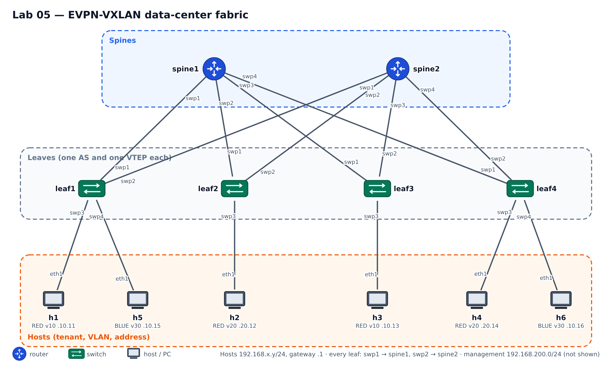

# Lab 05 — EVPN-VXLAN data-center fabric (2nd project, exercise 2)

**Topics:** leaf-spine (Clos) fabric, eBGP underlay with ECMP (RFC 7938), VXLAN overlay,
BGP EVPN control plane (route types 2, 3 and 5, RD/RT, VTEPs), multitenancy with VRFs,
symmetric IRB with L3VNIs, distributed anycast gateway, ARP suppression — and a fabric
configured **from a data model and templates**, not by hand.



```bash
python tools/cgr_lab.py build labs/lab05-evpn --start
```

The leaves need the kernel's VXLAN and VRF support. If `ifreload -a` on a leaf says
`Unknown device type` or `Operation not supported`, open the GNS3 VM console → *Shell* (Linux:
a terminal) and run `sudo modprobe -a vxlan vrf bonding 8021q dummy macvlan`. The modules are lost when
the VM restarts; to load them at every boot, once per VM:
`printf "vxlan\nvrf\nbonding\n8021q\ndummy\nmacvlan\n" | sudo tee /etc/modules-load.d/cgr.conf`.

## 1. The data center

A provider hosts two customers (**tenants**) in a small data center: four leaf switches (one
per rack) and two spines. Every leaf is connected to both spines; hosts are connected to the
leaves. The tenants must be completely separated — **BLUE even uses the same addresses as one
of RED's networks** — and a tenant's VLAN must be available in any rack, wherever its
servers (or virtual machines) happen to be.

This is the design of the data-center classes (SDN — *data-center network needs*:
automation, MAC/VLAN scale, multipathing, multitenancy) built with the control plane of the
service-provider classes (EVPN: MP-BGP, AFI 25 / SAFI 70). The provider networks of those
classes carry EVPN over MPLS; data centers carry it over **VXLAN** (the transport changes,
the control plane is the same).

**Table 1 — tenants and networks**

| Tenant (VRF) | L3VNI / its VLAN | Network | VLAN | L2VNI | Gateway | Hosts |
|---|---|---|---|---|---|---|
| RED | 5001 / 4001 | 192.168.10.0/24 | 10 | 10010 | 192.168.10.1 | h1 (leaf1), h3 (leaf3) |
| RED | | 192.168.20.0/24 | 20 | 10020 | 192.168.20.1 | h2 (leaf2), h4 (leaf4) |
| BLUE | 5002 / 4002 | 192.168.10.0/24 | 30 | 10030 | 192.168.10.1 | h5 (leaf1), h6 (leaf4) |

Gateway MAC (the same on every leaf): `00:00:5e:00:01:01`. Host addresses: figure above
(already configured on the hosts, `eth1`).

**Table 2 — underlay numbering plan**

| | spines | leafN (N = 1…4) |
|---|---|---|
| AS | 65000 (both) | 6510N (one per leaf) |
| loopback = router ID = VTEP | 10.0.0.1, 10.0.0.2 | 10.0.0.1N |
| link spineS – leafL | 10.S.L.0/31: spine .0, leaf .1 (e.g. spine2–leaf3 = 10.2.3.0/31) | |
| ports | spineS swpL → leafL | swp1 → spine1, swp2 → spine2, swp3/swp4 → hosts |
| management (eth0) | 192.168.200.31, .32 | 192.168.200.4N |

## 2. Requirements

1. **Underlay.** eBGP between every leaf and both spines (numbered /31 links, Table 2).
   Every loopback is reachable from every switch, and each leaf reaches the other leaves'
   loopbacks over **both spines (ECMP)**.
2. **EVPN.** The leaves are the VTEPs (source address = loopback) and exchange EVPN routes
   over the same BGP sessions (`l2vpn evpn` address family). The spines only relay EVPN
   routes: they have no VNIs, VRFs or hosts.
3. **Layer 2 overlay.** Each VLAN of Table 1 is one L2VNI. VLAN 10 is stretched between
   leaf1 and leaf3 (h1 ↔ h3 in the same subnet), VLAN 20 between leaf2 and leaf4, VLAN 30
   between leaf1 and leaf4. MAC addresses are learned through BGP, **not** by flooding over
   the VXLAN tunnels (`bridge-learning off` on the VXLAN interfaces), and the leaves answer
   ARP for known hosts themselves (ARP suppression).
4. **Layer 3 overlay.** Each tenant is a VRF with its own **L3VNI** (symmetric IRB). Every
   leaf is the default gateway (`.1`, same MAC) of the networks it has hosts in — a
   **distributed anycast gateway**. h1 reaches h2 and h4; h3 reaches h2 and h4.
5. **Multitenancy.** RED and BLUE cannot reach each other, although BLUE's network uses the
   same addresses as RED's VLAN 10.
6. **Configuration as code.** The whole fabric is described in **one data file,
   `fabric.yml`**, and the device files are rendered from it with **Jinja2 templates**
   (`generate.py`) and pushed with `deploy.py`. Nothing is configured by hand on the
   switches (`vtysh`/`ip` only to look). The leaves are almost identical: one template per
   role must serve all of them.

## 3. How to work

Everything happens on **netauto**, in `/root/cgr/fabric` (persistent):

| File | |
|---|---|
| `fabric.yml` | **your plan**: tenants, VLANs/VNIs, ASNs, loopbacks, links, access ports — started for you, complete it |
| `templates/spine_*.j2` | the spine templates (complete — read them first) |
| `templates/leaf_*.j2` | the leaf templates: underlay done, **overlay TODO** |
| `generate.py` | checks the plan (duplicates, /31s, VLANs used by access ports…) and renders `configs/<node>/{interfaces,frr.conf}` |
| `deploy.py` | pushes the rendered files over SSH: keeps the management part of `/etc/network/interfaces`, `ifreload -a`, `frr-reload` |

```bash
cd /root/cgr/fabric
./generate.py --show leaf1        # the variables leaf1's templates receive
./generate.py                     # check the plan + render configs/
less configs/leaf1/interfaces
./deploy.py --dry-run leaf1       # what would change on leaf1
./deploy.py                       # push everything (or only some: ./deploy.py leaf1 leaf2)
```

Suggested order: (1) complete the underlay part of `fabric.yml` for all leaves, generate,
deploy, check requirement 1; (2) the L2 overlay for VLAN 10 only, check h1 ↔ h3;
(3) the other networks; (4) the VRFs and L3VNIs, check routing and isolation.

### Verify (on the switches, read-only; from the hosts' GNS3 consoles)

```bash
vtysh -c 'show bgp summary'                       # underlay (IPv4) and EVPN sessions
ip route show 10.0.0.13                           # two next hops = ECMP over both spines
vtysh -c 'show evpn vni'                          # L2 and L3 VNIs, remote VTEPs
vtysh -c 'show bgp l2vpn evpn route type multicast'   # type 3: who floods BUM traffic to whom
vtysh -c 'show bgp l2vpn evpn route type macip'       # type 2: MAC (and MAC+IP) of the hosts
vtysh -c 'show bgp l2vpn evpn route type prefix'      # type 5: the tenants' subnets
vtysh -c 'show evpn mac vni 10010'                # MACs: local port or remote VTEP
vtysh -c 'show evpn arp-cache vni 10010'          # what ARP suppression answers with
ip route show vrf RED                             # the tenant's routing table on a leaf
bridge fdb show | grep vni10010                   # the kernel's view of the remote MACs
```
On the hosts: `ping`, `traceroute`. In GNS3, right-click a leaf–spine link → *Start capture*
to see the VXLAN packets (UDP 4789: outer IP = the two VTEPs, VNI, inner Ethernet frame).

## 4. ifupdown2 and FRR reference

```
iface RED                         # a VRF (Linux routing table chosen automatically)
    vrf-table auto

iface vni10010                    # a VXLAN interface = one VNI
    vxlan-id 10010
    vxlan-local-tunnelip 10.0.0.11
    bridge-access 10              # VLAN of the bridge mapped to this VNI
    bridge-learning off           # MACs come from EVPN, not from the data plane
    bridge-arp-nd-suppress on     # ARP suppression (L2VNIs)

iface bridge                      # one VLAN-aware bridge per leaf
    bridge-vlan-aware yes
    bridge-ports swp3 vni10010 vni5001
    bridge-vids 10 4001
    bridge-stp off

iface vlan10                      # SVI = the anycast gateway of VLAN 10
    vlan-id 10
    vlan-raw-device bridge
    address 192.168.10.1/24
    hwaddress 00:00:5e:00:01:01
    arp-accept on                 # why is this needed? (you will be asked)
    vrf RED
```
```
vrf RED
 vni 5001                         # the VRF's L3VNI
exit-vrf
router bgp 65101
 address-family l2vpn evpn
  neighbor SPINES activate
  advertise-all-vni               # advertise the local VNIs, their MACs and the type-3 routes
router bgp 65101 vrf RED
 address-family ipv4 unicast
  redistribute connected
 address-family l2vpn evpn
  advertise ipv4 unicast          # the VRF's routes as EVPN type-5 routes
```
Jinja2: `…`, ``,
`{{ node.loopback }}`, ``; `./generate.py --show leafN` lists the variables.

## 5. What to deliver

Only files: `fabric.yml`, your `templates/`, and the `configs/` they generate. On netauto
`./deliver.py`, then on your computer `python tools/cgr_lab.py fetch lab05-evpn` (see the
project statement). In the discussion the files are rendered and deployed on a fresh copy
of the lab, so they must work from scratch; be ready to change the plan live (a new
network, a host moved to another leaf, a third tenant) and to explain every route you see.
